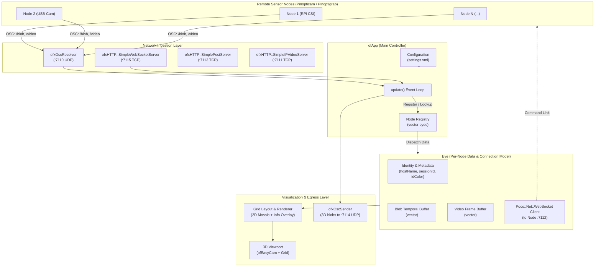
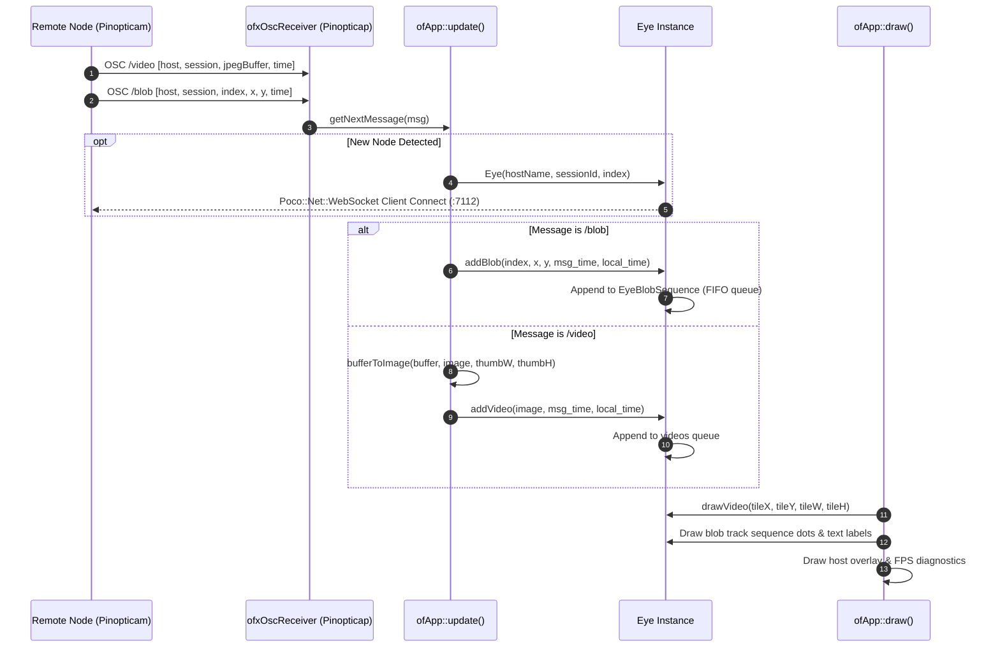

# Pinopticap Architecture

## 1. Overview

**Pinopticap** is the central multi-camera aggregation, capture, and visualization node within the **Pinopticon** computer vision ecosystem. Developed using [openFrameworks](https://openframeworks.cc/), Pinopticap connects to an array of distributed sensor nodes (such as Raspberry Pi cameras running *Pinopticam* or USB camera nodes running *Pinoptigrab*), ingests real-time computer vision tracking telemetry and video streams, maintains temporal tracking histories, and renders an interactive multi-node visualization grid with 3D workspace support.

```
+-----------------------------------------------------------------------+
|                         Pinopticon Ecosystem                          |
|                                                                       |
|  +-------------------+       OSC / WebSockets                         |
|  |    Pinopticam     | -----------------------------\                 |
|  | (RPi CSI Camera)  |                              |                 |
|  +-------------------+                              v                 |
|  +-------------------+       OSC / WebSockets  +---------------+      |
|  |    Pinoptigrab    | ----------------------> |  Pinopticap   |      |
|  |   (USB Camera)    |                         | (Aggregation, |      |
|  +-------------------+                         |  Tracking &   |      |
|  +-------------------+       OSC / WebSockets  | Visualization)|      |
|  | Other Sensor Nodes| ----------------------> +---------------+      |
|  |  (Lidar / Depth)  |                              |                 |
|  +-------------------+                              | Video / OSC     |
|                                                     v                 |
|                                                +---------------+      |
|                                                |  Pinoptiglue  |      |
|                                                | (Shader Mixer)|      |
+-----------------------------------------------------------------------+
```

---

## 2. System Architecture

Pinopticap is architected around an event-driven, polling-augmented aggregation pattern. Remote camera nodes publish vision telemetry (blobs, contours, and compressed video frames) over Open Sound Control (OSC) and WebSockets. Pinopticap automatically discovers and registers nodes, establishes back-channel WebSocket client connections to each node, and aggregates incoming data into a synchronized state machine for rendering and upstream relay.

### Architecture Diagram



---

## 3. Core Software Components

### 3.1 `main.cpp` — Application Bootstrap
- Configures graphics context and windowing backend:
  - **Embedded / ARM (`TARGET_OPENGLES`)**: Initialized with `ofGLESWindowSettings` (OpenGL ES 2.0).
  - **Desktop (`GLFW`)**: Initialized with `ofGLFWWindowSettings` with multisampling disabled (`numSamples = 0`) for lightweight rendering.
- Instantiates `ofApp` and starts the openFrameworks main event loop via `ofRunApp()`.

### 3.2 `ofApp` (`src/ofApp.h`, `src/ofApp.cpp`) — Main Controller
- **Lifecycle Management**:
  - `setup()`: Reads `bin/data/settings.xml`, computes grid window dimensions, starts network listeners (OSC receiver, optional HTTP, MJPEG, and WebSocket servers), and resolves the local device hostname and session ID.
  - `update()`: Drains the incoming OSC queue (`receiver.hasWaitingMessages()`), matches messages to remote Eye instances by hostname, dynamically registers new nodes, updates data buffers, triangulates the current blobs (`triangulateBlobs()`), and sends the resulting 3D blobs on over OSC (`sendOscBlobs(index, x, y, z)`).
  - `draw()`: If `debug` is enabled, renders the multi-camera mosaic grid, color-coded blob track trajectories, hostnames, frame rate, and reference 3D ground grid with the calibrated eyes and triangulated blobs in it (`drawWorld()`). The spacebar hides the mosaic.
  - `exit()`: Closes active WebSocket client connections across all `Eye` instances.
- **Node Tracking & Registration**:
  - `checkHostName(string hostName)`: Scans existing `eyes` for matching hostname.
  - `checkSessionId(string sessionId)`: Scans existing `eyes` for matching session ID (defined but currently disabled — the call site is commented out at `src/ofApp.cpp:103`).
  - Automatic connection: When a new node is observed, it instantiates an `Eye` object and triggers a client WebSocket connection back to the node (`eyes[whichOne].wsClientConnect(...)`).
  - Reconnection: If a known hostname reports a changed session ID, the `Eye` is updated and its WebSocket client reconnected (`src/ofApp.cpp:121-126`).
- **Network Servers**:
  - `ofxOscReceiver receiver`: Receives OSC packets from camera nodes.
  - `ofxOscSender sender`: Sends the triangulated 3D blobs to `osc_host`.
  - `ofxHTTP::SimpleWebSocketServer wsServer`: Inbound WebSocket server responding to commands such as `take_photo` and `stream_photo`.
  - `ofxHTTP::SimpleIPVideoServer streamServer`: Serves live MJPEG streams.
  - `ofxHTTP::SimplePostServer postServer`: Handles HTTP POST submissions and file uploads.

### 3.3 `Eye` (`src/Eye.h`, `src/Eye.cpp`) — Remote Sensor Node Abstraction
Each `Eye` object encapsulates the state and history of one physical camera node in the array:
- **Identity**:
  - `hostName`: Network hostname of the node (e.g., `camera-01`).
  - `sessionId`: Session ID generated by the node upon boot (`RPi_<timestamp>`).
  - `index`: Numeric zero-based ID in the active array.
  - `idColor` / `bgColor`: Pseudo-random pastel colors used for visual differentiation in the UI (`ofRandom`, unseeded — `src/Eye.cpp:9-15`).
- **Websocket Client (`wsClient`)**:
  - Direct `Poco::Net::WebSocket` client session connecting to `http://<hostName>.local:<wsClientPort>/?encoding=text`.
- **Blob History Ring Buffer**:
  - `EyeBlob`: Represents a single detected blob `(index, x, y, timestamp, diff, received)`. Note the stored `timestamp` is the arrival latency `|local − remote|` (`src/Eye.cpp:59-63`); the declared `diff` field is never written by current code. `received` is the local arrival time.
  - `EyeBlobSequence`: Retains a temporal history (`vector<EyeBlob>`) of a specific blob ID.
  - Ring buffer bounds: Capped at `numSamples` (30 frames) per blob sequence and `numBlobSequences` (200 unique tracks) — both hardcoded in `src/Eye.cpp:14-15`, not configurable via settings.xml.
- **Calibration**:
  - `calibration` / `calibrated`: The node's `EyeCalibration`, set at registration if the calibration file has a shot for its hostname.
- **Video Buffer**:
  - `EyeVideo`: Holds decoded `ofImage` frame, arrival latency (stored in `timestamp`, `src/Eye.cpp:103-104`), and an unused `diff` field.
  - History buffer capped at `numSamples` (30 frames).
  - `drawVideo(x, y, w, h)`: Renders the latest received video frame.

### 3.4 `Triangulation.hpp` (`src/Triangulation.hpp`) — Calibration & 3D Triangulation
Header-only, so it needs no entry in the Xcode or Visual Studio projects:
- **`EyeCalibration`**: Position, orientation, focal length, and radial distortion of one camera. `ray(x, y)` turns a normalized image position into a ray direction in the world.
- **`loadEyeCalibrations(filename)`**: Reads an OpenSfM `reconstruction.json` (perspective cameras) into a map keyed by hostname. A shot named `<hostName>_<anything>.jpg` calibrates the node with that hostname.
- **`RayIntersector`**: Closed-form least-squares intersection of any number of rays, one symmetric 3x3 system.
- **`fitRays(rays, n, skip, x, worst, worstError, total)`**: Intersects the rays still in play, optionally without one of them, weighted by 1 / depth². Reports the angle by which the worst ray misses the point and the sum over all rays.
- **`intersectRays(rays, n, maxAngle, x)`**: Fits the rays and, as long as one misses the point by more than `maxAngle`, leaves one out. With up to 16 rays in play it tries each ray and leaves out the one without which the rest fit best (leave-one-out); with more, it leaves out the ray that misses by most. Gives no point unless at least two rays, and more than half of them, agree.
- **Use in `ofApp`**: Each `update()`, the newest blob of every sequence received within the last three camera frames becomes a ray. Rays that share a blob index are intersected, so indices must mean the same point in every camera. Results are held in `blobs3d` and sent on as 3D `/blob` messages (section 4.2).

### 3.5 Shared Common Headers (`Pinopticon/core/common/src/`)
Pinopticap links directly against the Pinopticon shared core headers:
- **`Pinopticon.hpp`**:
  - `getSessionId()`: Generates unique session keys (`RPi_%y%m%d%H%M%S%i`).
  - `getHostName()`: Resolves local host identity (reading `/etc/hostname` on Linux).
  - `imageToBuffer()` / `bufferToImage()`: High-performance JPEG compression and decompression between `ofImage` / `ofPixels` and raw `ofBuffer` packets.
  - `rawDepthToMeters()`: Depth conversion utility for 3D sensors.
- **`Pinopticon_Osc.hpp`**:
  - Serialization routines for sending OSC blobs, contours, video frames, and brightest pixels.
- **`Pinopticon_Http.hpp`**:
  - Server initialization helpers for `ofxHTTP` (MJPEG video, WebSocket server, HTTP post server).
  - WebSocket JSON payload builders for broadcast streaming.

---

## 4. Networking & Protocols

### 4.1 Network Port Allocations

| Port | Protocol | Role | Direction | Config Key |
| :--- | :--- | :--- | :--- | :--- |
| **7110** | UDP (OSC) | Inbound telemetry & frame receiver | Inbound | `osc_receive_port` |
| **7111** | TCP (HTTP) | MJPEG live stream server (`live_view.html`) | Outbound / Server | `stream_port` |
| **7112** | TCP (WS) | Remote node WebSocket service (Pinopticap connects as client) | Outbound / Client | `ws_client_port` |
| **7113** | TCP (HTTP) | HTTP POST and upload server (`result.html`) | Inbound / Server | `post_port` |
| **7114** | UDP (OSC) | Outbound sender of triangulated 3D blobs | Outbound | `osc_send_port` |
| **7115** | TCP (WS) | Central WebSocket command & broadcast server | Inbound / Server | `ws_server_port` |

### 4.2 OSC Protocol Messages

Pinopticap listens on port `7110` for OSC packets emitted by nodes, and sends the 3D `/blob` itself:

| Address | Type Tag | Arguments | Description |
| :--- | :--- | :--- | :--- |
| `/blob` | `ssiffi` | `string hostName`<br>`string sessionId`<br>`int32 blobIndex`<br>`float x`<br>`float y`<br>`int32 timestamp` | Normalized 2D center coordinates of a tracked blob. |
| `/blob` (3D) | `ssifffi` | `string hostName`<br>`string sessionId`<br>`int32 blobIndex`<br>`float x`<br>`float y`<br>`float z`<br>`int32 timestamp` | A triangulated blob, **sent by Pinopticap** to `osc_host`:`osc_send_port`. `hostName` and `sessionId` are Pinopticap's own, `blobIndex` is the index the nodes reported the blob under, and x, y, z are in the units of the calibration file. |
| `/video` | `ssbi` | `string hostName`<br>`string sessionId`<br>`blob videoBuffer`<br>`int32 timestamp` | JPEG-compressed image frame buffer. |
| `/contour` | `ssibbi` | `string hostName`<br>`string sessionId`<br>`int32 contourIndex`<br>`blob colorBuffer`<br>`blob pointsBuffer`<br>`int32 timestamp` | Serialized contour geometry and color payload. **Handled as a no-op in current code** — the handler body is commented out (`src/ofApp.cpp:149-160`). |
| `/pixel` | `ssffi` | `string hostName`<br>`string sessionId`<br>`float x`<br>`float y`<br>`int32 timestamp` | Coordinates of brightest pixel baseline tracking. **Not handled by Pinopticap** — no `/pixel` branch exists in `update()`; this message type is defined in `Pinopticon_Osc.hpp` for other apps in the ecosystem. |

### 4.3 WebSocket JSON Payloads

**Not currently emitted by Pinopticap.** The JSON builders (`sendWsVideo`, `sendWsBlobs`, `sendWsContours`, `sendWsPixel`) exist in `core/common/src/Pinopticon_Http.hpp:76-94` and are used by the *sender* apps (Pinopticam etc.), but Pinopticap itself never calls them — its WebSocket server (`:7115`) only accepts and logs inbound commands (`take_photo` / `stream_photo` handlers at `src/ofApp.cpp:348-353` are commented-out stubs). Payload shapes, for reference:

```json
// Blob Telemetry (emitted by node apps, not by Pinopticap)
{
  "unique_id": "RPi_250108120000000",
  "hostname": "camera-01",
  "index": "0",
  "x": "0.452",
  "y": "0.681",
  "timestamp": "1736340000000"
}

// Video Frame Telemetry (emitted by node apps, not by Pinopticap)
{
  "unique_id": "RPi_250108120000000",
  "hostname": "camera-01",
  "video": "<base64_encoded_jpeg>",
  "timestamp": "1736340000000"
}
```

---

## 5. Data Flow & Processing Lifecycle



---

## 6. Configuration Reference (`bin/data/settings.xml`)

| Setting | Shipped Value | Code Fallback | Description |
| :--- | :--- | :--- | :--- |
| `osc_host` | `Example.local` | `127.0.0.1` | Destination hostname/IP for the 3D blobs. Nothing is sent while the name does not resolve |
| `osc_receive_port` | `7110` | `7110` | Port to receive incoming OSC messages from nodes |
| `stream_port` | `7111` | `7111` | Port for the MJPEG HTTP video stream |
| `ws_client_port` | `7112` | `7112` | Port on remote nodes to connect outbound WebSocket clients |
| `post_port` | `7113` | `7113` | Port for the HTTP POST server |
| `osc_send_port` | `7114` | `7114` | Port the 3D blobs are sent to |
| `ws_server_port` | `7115` | `7114` ⚠️ | Port for the inbound WebSocket server. **The code fallback (`src/ofApp.cpp:38`) is 7114, colliding with `osc_send_port`** — rely on settings.xml, which ships 7115 |
| `app_framerate` | `60` | `60` | Target application frame rate (FPS) |
| `cam_framerate` | `40` | `30` | Remote camera sync rate reference |
| `width` / `height` | `640` / `480` | (unused) | Fallback display resolution — overridden by the hardcoded 3×3 grid in setup (`src/ofApp.cpp:26-29`) |
| `debug` | `1` | `1` | Enable local GUI rendering, overlays, and 3D grid |
| `calibration_file` | `reconstruction.json` | `reconstruction.json` | OpenSfM reconstruction in `bin/data` giving each node's pose and lens; without it nothing is triangulated |
| `max_ray_angle` | `1.0` | `1.0` | Largest angle, in degrees, by which a camera's ray may miss a triangulated blob (converted to radians at `src/ofApp.cpp:53`) |
| `send_osc` | `1` | `1` | Enable/disable outbound OSC sending |
| `send_ws` | `1` | `1` | Enable/disable WebSocket server |
| `send_mjpeg` | `0` | `1` | Enable/disable MJPEG streaming server |
| `send_http` | `0` | `1` | Enable/disable HTTP POST server |
| `max_stream_connections` | `5` | `5` | Maximum concurrent MJPEG stream connections |
| `max_stream_bitrate` | `256` | `512` | Maximum bit rate for stream compression |
| `max_stream_framerate` | `30` | `30` | Maximum frame rate for video stream |
| `max_stream_queue` | `1` | `10` | Stream frame queue depth |

Code fallbacks are the second arguments of `settings.getValue("settings:<key>", <fallback>)` in `src/ofApp.cpp:18-76`.

---

## 7. Build System & Dependencies

### 7.1 openFrameworks Addons (`addons.make`)
- **`ofxOpenCv` / `ofxCv`**: Computer vision types, geometric coordinate transforms, and OpenCV bindings.
- **`ofxOsc`**: Open Sound Control message generation and dispatch over UDP.
- **`ofxXmlSettings`**: XML parsing for application configuration.
- **`ofxHTTP`**: High-performance HTTP, MJPEG, and WebSocket server suite based on Poco.
- **`ofxPoco` / `ofxNetworkUtils` / `ofxIO` / `ofxMediaType` / `ofxSSLManager`**: Core networking, thread management, and I/O utilities.
- **`ofxJSON`**: JSON document serialization and deserialization.
- **`ofxCrypto`**: Cryptographic functions and Base64 string encoding.

### 7.2 Platform & Toolchain Support
- **Linux (Raspberry Pi / ARM64 & ARM32)**:
  - Standard Makefile: `Makefile` + `config.make`.
  - Compiler optimizations: `-march=native -mtune=native -Os`.
  - Linker dependencies: `-latomic`.
  - Scripts: `setup.sh` (installs `xvfb`, `xorg`, NTP utilities, and clones dependencies), `get-bin.sh` (retrieves binary releases).
- **macOS**:
  - Xcode project (`Pinopticap.xcodeproj`) with `Project.xcconfig`.
- **Windows**:
  - Visual Studio Solution (`Pinopticap.sln`, `Pinopticap.vcxproj`).

---

## 8. Directory Structure

```
Pinopticap/
├── ARCHITECTURE.md          # System architecture and technical documentation
├── README.md                # Project landing page and branding
├── Makefile                 # Linux Makefile build entrypoint
├── config.make              # Compilation flags and target optimizations
├── addons.make              # List of required openFrameworks addons
├── setup.sh                 # Environment setup and addon dependency installation
├── get-bin.sh               # Shell script for fetching precompiled binary
├── bin/
│   └── data/
│       └── settings.xml     # Application network and runtime configuration
├── src/
│   ├── main.cpp             # Window creation and application entry point
│   ├── ofApp.h              # Main application header and network server declarations
│   ├── ofApp.cpp            # Main application loop, OSC ingestion, and UI rendering
│   ├── Eye.h                # Eye node model and blob history header
│   ├── Eye.cpp              # Eye implementation, WebSocket client, and buffer management
│   └── Triangulation.hpp    # Camera calibration loader and N-view ray triangulation
├── tools/
│   └── camera_sim/          # Simulated camera array sending OSC /blob from a shared 3D scene
├── docs/
│   └── images/              # Documentation assets and logos
├── Pinopticap.xcodeproj/     # Apple macOS Xcode project files
├── Pinopticap.sln           # Microsoft Visual Studio solution
├── Pinopticap.vcxproj       # Microsoft Visual Studio C++ project configuration
└── openFrameworks-Info.plist# macOS bundle property list
```
